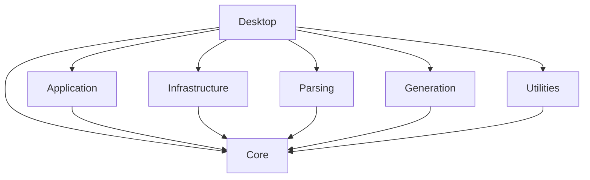

# ProtoBench

[Download the app and SDK](https://github.com/michaelyu-code/ProtoBench/releases/latest) | [Builds and releases](docs/RELEASING.md)

A local Windows engineering toolkit built with WinUI 3, C# and .NET 10. This foundation includes working Base Converter, Log Parser and File Generator workspaces. Parser specs are supplied by extensions or custom user definitions; none are bundled. The shipped generator is a **synthetic framework example**.

The app launches as `ProtoBench.exe`. Projects, namespaces, SDK assemblies and imports use `ProtoBench.*`; user data lives under `%LOCALAPPDATA%/ProtoBench`. SDK API 2 requires extensions to be rebuilt against the new assemblies and their manifests to declare `apiVersion: 2`.

## Build and run

Requirements: Windows 10 1809 or newer (Windows 11 recommended), x64, .NET SDK 10.0.302 or a newer 10.0 patch, and access to NuGet during restore. The project targets the Windows 11 SDK 10.0.26100. Visual Studio is optional for command-line builds; for IDE work install the WinUI application development tooling and .NET 10 support.

From this directory:

```powershell
dotnet restore ProtoBench.slnx
dotnet build ProtoBench.slnx --no-restore
dotnet test ProtoBench.slnx --no-build --no-restore
dotnet run --project src/ProtoBench.Desktop
```

Close running toolkit instances before rebuilding. The solution maps Desktop to x64; the libraries and tests use Any CPU. Direct project builds may use `bin/Debug`, while solution builds use `bin/x64/Debug` for Desktop. Use `dotnet run` to select the appropriate output automatically, or run `run.ps1` for a consistent x64 build and launch.

The app is unpackaged and includes its Windows App SDK runtime; no MSIX deployment or backend is needed. The .NET 10 desktop runtime is required when running an ordinary build on a different computer. For a self-contained deployment:

```powershell
dotnet publish src/ProtoBench.Desktop -c Release -r win-x64 --self-contained true -p:Platform=x64 -o artifacts/publish
```

Distribute the complete publish directory, not just the executable. Default builds make no network requests and need no accounts or server dependencies. NuGet restore is a development-time operation.

Update support is implemented but disabled by default. See [update configuration and release preparation](docs/UPDATES.md) before enabling it in a future release.

## Architecture



- **Core:** documents, hierarchical fields, byte/character source ranges, diagnostics, strict encodings and local persistence contracts.
- **Application:** tool descriptions and categories, immutable tool registry, independent workspace lifecycle, cancellation and observable operation state. Uses CommunityToolkit.Mvvm without referencing WinUI.
- **Parsing:** parser contracts, registry, validation and JSON-defined delimited, fixed-width and named-group regex engines. C# implementations use the same registry.
- **Generation:** generator contracts, registry, validation and byte-oriented fixed-width generation. C# generators use the same registry.
- **Utilities:** reusable arbitrary-precision base conversions, strict ASCII/hex byte conversions, and IBM EBCDIC CP500 conversion.
- **Infrastructure:** atomic local writes, JSON settings, isolated definition loading, rotating content-free error logging.
- **Desktop:** composition root, WinUI views, ViewModels, view factories, native file pickers, clipboard, dashboard and tab shell.

Tools are user-facing workspaces. Parsers and generators are implementations selected within those workspaces. Adding a format does not add a navigation item. The shell discovers tools and view factories through DI and has no tool-specific navigation switch.

## Workflows

- **Tool layouts:** converters, calculators and payment tools use compact input/result panels side by side when there is at least 692 pixels of content width, and stack vertically below that. Related options share responsive rows, long instructions live in a collapsed **Help & examples** panel, and empty messages/inactive progress indicators take no space. EMV uses a compact operation/value row above a full-width byte editor, with the eight bit controls arranged in two columns when space permits; its decoded text is collapsible. Generator previews switch between Text and Hex bytes in tabs. The parser places records beside a tabbed Fields / Original text inspector on wider windows. Inputs and selections stay intact when the layout reflows.

- **Calculators:** the Calculators category includes three independent local tools, available in dashboard search and the new-tab picker. Each has Calculate, Clear inputs and Copy result. Inputs are not saved or transmitted.
  - The **3DES Key check value (KCV)** field shows the first 3 bytes (6 hex digits) of encrypting `0000000000000000` with the supplied key in ECB without padding. Successful Encrypt/Decrypt calculations also populate it. **Calculate KCV** needs only a valid key; selected data mode, IV, padding and transaction data do not affect this value. **Copy KCV** copies only the six hex digits. Changing the key or clearing inputs removes the previous KCV. This uses the encrypt-zero convention described by [ID TECH](https://idtechproducts.atlassian.net/wiki/spaces/KB/pages/71720953/How+does+one+split+combine+cryptographic+keys): test key `0123456789ABCDEFFEDCBA9876543210` yields `08D7B4`.
  - **Bitwise Calculator:** AND, OR, XOR, NOT, logical shifts and rotations on unsigned 8/16/32/64-bit operands. Choose binary, decimal or hex input; `0b`/`0x` prefixes are optional in the matching base. Results show decimal plus width-padded hex and binary. Operands outside the selected width are rejected. Shift/rotation counts are always decimal, from zero through the width. Left shifts discard overflow; right shifts fill with zeroes. Shifting by the full width produces zero; rotating by the full width preserves the value. Example: hex `F0 XOR 0F` at 8 bits gives `FF`, decimal `255`, binary `11111111`.
  - **Base64:** encode UTF-8 text or hex bytes and decode to strict UTF-8 or hex bytes. Standard mode uses padding; URL-safe mode emits `-`/`_` without padding and accepts padded/unpadded input. Decode ignores whitespace but rejects mixed alphabets, malformed padding and nonzero pad bits. Binary data that is not valid UTF-8 must be decoded to hex. Empty data is supported. Maximum 16,384 data bytes, with a 65,536-character encoded/hex input cap. Example: `Hello` ↔ `SGVsbG8=`. Definitions and test vectors follow [RFC 4648](https://www.rfc-editor.org/rfc/rfc4648).
  - **3DES Calculator:** encrypt/decrypt hex bytes using ECB or CBC, a 16-byte two-key or 24-byte three-key EDE key, and None, PKCS7 or zero padding. Two-key inputs are expanded explicitly to K1/K2/K1 for the Windows provider. CBC requires an explicit 8-byte IV; ECB ignores the hidden IV field. No-padding input and all ciphertext require complete 8-byte blocks. PKCS7 is validated/removed on decrypt; zero padding is retained because trailing zeroes can be real data. Weak/degenerate 3DES keys are rejected. Inputs are limited to 16,384 bytes (16,383 for PKCS7 plaintext), and empty input is rejected. Keys are masked; Clear inputs and tab disposal release workspace references, and temporary byte arrays are cleared. Managed strings cannot be guaranteed erased from memory. Reference vectors include NIST SP 800-67 Appendix B and a two-key example published by [PyCryptodome's 3DES tests](https://github.com/Legrandin/pycryptodome/blob/master/lib/Crypto/SelfTest/Cipher/test_DES3.py).

- **Payments:** four local workspaces are available from the Payments sidebar category, dashboard search and new-tab picker. Each supports independent tabs, Copy result and Clear inputs. Inputs and keys are not persisted or transmitted.
  - **EMV Tag Decoder:** 13 tags and 19 explicit scheme/profile combinations, including Visa FFI, Mastercard Third Party Data, American Express reader capabilities, TTQ/CTQ, CVM Results/List, AUC, CID, Terminal Type and the original contact bit fields. Choose the tag and its Scheme / profile; Load example supplies a matching value. Coded fields show a summary, while byte tabs preserve interactive bit editing. Common-only TLV decoding retains ambiguous scheme tags as raw data; explicit scheme contexts interpret only matching supported profiles. See [supported tags, examples and profile limits](docs/EMV-PROFILES.md).
  - **ISO 8583 Bitmap:** decode an 8/16-byte hex bitmap or 64/128 binary digits; encode comma/whitespace-separated data field numbers 2–128. `3,4,11,41` produces `3020000000800000`. Bit 1 is generated automatically for a secondary bitmap and validated on decode. This primary/secondary profile treats DE65 as data and does not support tertiary bitmaps or parse message bodies. Host-specific field definitions are not inferred.
  - **Luhn Check Digit:** validate a complete 2–19 digit number, or calculate the final digit for a 1–18 digit prefix. Ordinary spaces and hyphens are ignored; other non-ASCII digits and punctuation are rejected. Leading zeroes are retained. Prefix `7992739871` yields digit `3`. This is a checksum check, not card/account validation.
  - **ARQC Calculator:** calculate an 8-byte application cryptogram using an explicitly supplied 16-byte AC session key and assembled, unpadded transaction data. Supports ISO/IEC 9797-1 algorithm 3 (retail MAC), zero IV, padding method 2 (`80` followed by zeroes, always adding padding) or method 1 (zeroes to a block boundary). Optionally compare an expected 8-byte ARQC. The exact data order and padding must match the card/CVN profile; issuer/ICC master-key derivation, scheme-specific CVN assembly and AES are outside this tool's scope. The session key is masked in the UI; Clear inputs or closing the tab releases the workspace's references. Managed strings cannot be guaranteed erased from memory. Temporary key/data byte arrays are cleared after calculation, and .NET rejects weak/semi-weak DES components. Reference vector: key `29B33180E567CE38EA4CBC9D753B0E61`, data `0123456789ABCDEF0123456789ABCDEF`, method 2 → `FA624250B008B59A` ([PyEMV AC implementation and examples](https://github.com/knovichikhin/pyemv/blob/master/pyemv/ac.py)).

- **Converter:** choose input/output bases (2, 10, 16), enter a signed value, Convert, then Copy result. `0x` and `0b` prefixes are accepted for their respective bases. Negative values use a leading minus sign; no implicit two's complement or bit width. Inputs are limited to 16,384 characters.
- **Remove spaces from input** is an optional checkbox shared by all conversion modes. It starts unchecked in each workspace. When checked, ordinary spaces (`U+0020`) are removed before conversion: numeric `FF FF` is read as `FFFF`, for example, and text `A B` is read as `AB`. The entered text stays unchanged, tabs and line breaks are retained, and converted output is not stripped. Changing the checkbox clears the previous result so it can be recomputed.
- In the converter's **Conversion** selector, choose **ASCII → Hex** or **Hex → ASCII** for text conversion. `Hello` becomes `48 65 6C 6C 6F`. Hex input accepts contiguous pairs (`48656C6C6F`) or whitespace between complete byte pairs. Prefixes and punctuation are rejected in this mode. ASCII is strictly `00–7F`; non-ASCII text and bytes above `7F` produce an error instead of replacement characters. Spaces, line breaks and control characters are preserved (control bytes may be invisible in the result). Empty input converts to empty output. Conversion is limited to 16,384 ASCII bytes; hex input is also capped at 65,536 characters including whitespace. Copy result copies the literal converted text.
- For **EBCDIC CP500**, choose **Text → EBCDIC CP500 (hex)** or the reverse. `Hello` becomes `C8 85 93 93 96`. The explicit byte-to-byte modes **ASCII hex → EBCDIC CP500 hex** and the reverse convert `41 42 43` ↔ `C1 C2 C3`. Text mode supports the characters representable in CP500, including accented letters; the ASCII destination strictly rejects characters outside ASCII. CP500 is IBM EBCDIC International, distinct from CP037 and the Euro variant CP1148 ([Microsoft code page identifiers](https://learn.microsoft.com/en-us/windows/win32/intl/code-page-identifiers)). No best-fit or replacement fallback is allowed, so characters such as `€` and emoji produce errors. Spaces, line endings and controls are preserved without normalization; invisible control characters may appear blank. These modes share the hex syntax and size limits above. CP500 support currently belongs to the converter; parser/generator JSON encoding options remain `ascii` and `utf-8`.
- **Parser:** Import a parser extension through Settings and restart, or supply custom user definitions. Open a file, paste text, or paste a local path and Parse path. Automatic detection returns candidates by priority; ambiguous detection requires manual selection. Select a result row to inspect raw text and hierarchical fields with source offsets.
- **Generator:** select the synthetic template, edit the string-valued JSON input object, Preview, then Save file. The default input produces `46 58 41 4C 50 48 41 20 20 20 30 30 34 32 0D 0A`. The exact expected bytes are in `samples/synthetic-generated.bin`.
- Dashboard stays pinned beside workspace tabs. Clicking a tool in the sidebar, or **Open** on its card, returns to an existing instance when one is open. Use **New tab** on the card for another independent instance, labelled with an instance number. The **+** button opens a searchable **New tab** picker with the search field focused. Click a tool, or press Enter when search has one result, to create another independent workspace. The picker closes and the new workspace remains selected. Pressing **+** while a picker is already open returns to that picker and clears its search. Close a workspace tab to cancel its operation and dispose its resources. Favorites and the last 15 opened/saved paths persist locally. Settings opens in its own tab and supports system, light and dark themes.
- The integrated WinUI title bar includes the sidebar toggle and native minimize/maximize/close controls. Its background and caption colors track the selected theme, including inactive-window colors. The operating system retains native window dragging, snapping and close-button hover behavior. This uses the [WinUI TitleBar control](https://learn.microsoft.com/en-us/windows/apps/develop/ui/controls/title-bar).
- The sidebar is 220 device-independent pixels wide and collapses below an 880-pixel window width. Category groups expand/collapse, and the navigation menu scrolls vertically when it overflows, independently of the main content; Settings stays in the footer. With more than eight registered tools, category groups start collapsed. Dashboard offers search, a category/favorites filter, and a tool grid that reflows between one and three columns. Dashboard content scrolls vertically, with no horizontal scrolling. New categories and tools appear from registry data without editing the shell.

## Add a tool

External developers can package tools, parsers, generators and field decoders as DLL plugins. Import them through **Settings → Plugins & custom tools**, then restart. Tools appear under **Custom Tools** and support independent tabs. See the [plugin SDK, sample package and developer guide](docs/PLUGINS.md).

Run `./scripts/Build-DeveloperKit.ps1` to build a shareable SDK kit with dependencies, standalone standard/WinUI starter projects, packaging tools, documentation and a matching test app. It creates `artifacts/developer-kit/` and `artifacts/developer-kit.zip`; use a new `-OutputDirectory` for later builds or `-SkipApp` to omit the test app.

1. Implement reusable business services in a library without UI dependencies.
2. Implement a ViewModel deriving from `ToolWorkspace`. Give it a stable `ToolId` and `Title`; use `RunAsync` for cancellable operations. Use Toolkit observable properties/commands as appropriate. Snapshot mutable inputs before worker tasks, and publish results on the UI context.
3. Implement `IWorkspaceViewFactory`, returning the view for that ID. View factories contain presentation wiring; business logic belongs in services or the ViewModel. Prefer XAML for templated controls such as TreeView.
4. In `App.xaml.cs`, register the services, one `ToolDescriptor`, a `WorkspaceFactory<T>` as `IToolWorkspaceFactory`, and the view factory as `IWorkspaceViewFactory`.
5. Add library tests and run the Windows UI smoke checks. No core navigation change is required. `WorkspaceManager` owns workspace disposal; factories use `ActivatorUtilities` so the root provider does not retain closed transient workspaces.

## JSON definitions

The reusable [spec-to-tool-config skill](skills/spec-to-tool-config/SKILL.md) reads Markdown specifications and creates message profiles, log parser definitions, or fixed-width generator definitions with a source-mapping report. Invoke it with `$spec-to-tool-config Read <path-to-spec.md> and generate the configuration for this app`. Its validator uses the current C# schema readers; requirements outside those schemas are reported as gaps.

The app bundles only the generator example under `definitions/generators`. Parser and message specs load from enabled extensions or the separate per-user directories described below. Old parser/message files in the app output are ignored. Restart the app to load changes. Use unique definition IDs; duplicate IDs are diagnosed and skipped. Unsupported schema versions, unknown properties, invalid rules and oversized definitions produce startup notifications without discarding valid files.

In **Settings**, select **Open schema JSON folder** to open the custom definitions directory in File Explorer. Place parser JSON files in `parsers` and generator JSON files in `generators`.

Synthetic parser examples and engine-test rules are retained under `tests/Fixtures/definitions` for tests only. The generator example remains in `definitions/`. Version 1 intentionally supports a small rule vocabulary; it cannot execute scripts or arbitrary code.

### Parser schema version 1

Required identity: `id`, `name`. Set `schemaVersion: 1`. Common properties: `encoding` (`utf-8` or `ascii`), `detectionPrefix`, `detectionPriority`, `strategy`, and `fields` (1–256 unique names).

- `delimited`: `delimiter` contains 1–8 literal characters. Fields map in array order. Field counts must match exactly. This is **not CSV**: quoting, escaped delimiters and embedded record newlines are unsupported.
- `fixed-width`: each field has zero-based `start` and positive `length`, measured in decoded **UTF-16 code units**. Short records produce diagnostics. Trailing unused characters are allowed.
- `regex`: `pattern` is a .NET regular expression with a named capture group for each field. Capture offsets locate original data. Each match has a 100 ms timeout; patterns are limited to 4096 characters. Repeated capture groups expose the final capture. Unmatched fields produce diagnostics.
- Every field supports `transform`: `none`, `trim`, `upper`, or `lower`. Source ranges describe the untransformed text.

Lines use LF or CRLF. An initial UTF-8 BOM is accepted. `SourceRange.ByteOffset` is absolute in the original stream (including BOM and record separators); `ByteLength` is the original encoded field length. `CharacterOffset` and `CharacterLength` are record-relative UTF-16 offsets after BOM removal. Byte offsets and character offsets are never interchangeable. ASCII and UTF-8 use strict decoding. Definitions cannot choose an unspecified EBCDIC code page or byte order.

Log Parser streams files and clipboard text into a disposable SQLite disk index without a total file-size or record-count preview limit. It shows **2,000 message summaries per page** by default (100/250/500/1,000/2,000 options), with previous/next controls and a page-number picker. Search, field filters, directions, roles and sorting apply to the full indexed log. Only the selected message's full decoded payload is loaded; results and field panels expand down the main page rather than using nested vertical scrollbars. Specification tables retain horizontal scrolling.

The Messages and record inspector panels share the same height when displayed beside each other. After parsing, the input panel collapses and the page scrolls to the result count and paging controls. Disable **Settings → Log Parser → Automatically scroll to results after parsing** to keep the input panel open and retain your scroll position. The preference is saved and applies immediately to open parser workspaces; it is enabled by default.

**Settings → Log Parser → Auto-fit log parser results to the window** adapts result column widths, text size and spacing to the available window width and height. It is enabled by default, remembers your preference, and updates open parser workspaces immediately. Short windows use compact message and field rows and cap enlarged text so the bottom of ordinary messages is visible sooner. Shared text size and spacing depend only on the window dimensions, so opening or closing field details does not rescale the results. Long decoded fields scroll within the detail panel. In dense tables, row descriptions are available on hover instead of taking a second line; field names and values remain visible. The message-card list has a bounded viewport and its own scrollbar; its height matches the inspector beside it, so loading more messages cannot stretch the results row. Narrow windows give the stacked message list a separate bounded viewport. The field list and detail panel have independent scroll areas. With auto-fit enabled, field details stay beside the fields when their shared area has at least 532 logical pixels; long specification lines use horizontal scrolling instead of forcing the panel underneath. Side-by-side detail headings and controls stay fixed while tab contents scroll. In narrower windows, the stacked detail panel also scrolls as a whole, so the value, action buttons and tabs remain reachable even when its allocated height is short. The paging controls share one row when there is enough width. Narrow windows move field details below the field list; wide windows give the details about two thirds of the field area, without a fixed maximum width.  Specification tables retain monospaced alignment and get more space when their tab is selected; horizontal scrolling remains available when a table cannot fit at a readable size. Text stays at least 12 DIPs and respects Windows text scaling; long messages and large pages still use the main scrollbar. The message panel has a shared height across Fields, Original, Checks and Related; long content scrolls within each tab. Field details also have a shared height across Decoded, Checks and Specification, with independent scrolling for overflowing tab content. Specification content also scrolls horizontally to preserve table columns. Switching field tabs keeps the same width, typography and outer height. Turn Auto-fit off to restore the standard column, spacing and font sizes; the detail resize handle still supports manual adjustment.

**Results view → Table** displays one message per row, with blue request rows and purple reply/response rows. The existing search, direction/role filters, sorting and paging apply to both views. Use **Columns** to search for and show/hide metadata or field columns, or select all/clear them. Fields available elsewhere in the indexed log are included in the picker, even if absent from the current page. MTI is frozen on the left by default when available. Use **Freeze** beside any column in the picker, or right-click its header, to freeze/unfreeze it; multiple columns can stay visible together. Initial widths fit the widest header or value on the current page, up to 1,200 DIPs, then text wraps. Drag header edges to resize columns, or focus a resize handle and use Left/Right; Home or the header **Fit to contents** menu restores the measured width. Manual widths, column selections and freeze choices are retained while switching views in the workspace. Hold the middle mouse button and move the pointer away from its starting point to scroll continuously in that direction on either axis. Distance controls speed; returning near the starting point pauses movement. Release the button or press Esc to stop. Field cells use the existing checks: red for violations (including missing mandatory fields), yellow for warnings/review; fields with no findings have no indicator. Request/reply row colors remain visible. Field findings are stored as compact issue severities in the disk index, including plugin findings identified by field name. Double-click a row or choose **Open message details** to inspect its full decoded record. The table reads selected raw field values from the disk index and vertically virtualizes rows. Previews are bounded to 4,096 characters per cell and 4 MiB of value characters per page; shortened values are explicitly marked. The column catalog is bounded to 512 distinct fields with keys up to 256 characters; an on-screen notice identifies catalog limits. Full record values remain available in message details.

The Original tab displays blank lines and indentation without extra paragraph spacing. **Copy original** and copying selected text preserve the line endings supplied by the parser or extension.

**Missing RECORD headers:** the message parser can recover messages beginning with a line-start MTI assignment such as `Msg-type=0800` (or the MTI label configured by the profile). The first MTI after a valid header belongs to that record; another line-start MTI starts a recovered message. Recovery works for pasted text and files, including mixed normal/headerless logs, and preserves source offsets. Recovered messages show a warning and source-line label; record number, date/time, direction, connection, sequence and process remain unknown. Request/reply is derived from the MTI. Automatic detection requires an MTI recognized by the profile; manually select a profile to inspect an unknown four-digit MTI. Arbitrary field fragments without an MTI cannot establish a message boundary.

**Settings → Log Parser → Verbose checks** is off by default. Enable it to show check types, outcomes, explanations and rule IDs in the message and field Checks tabs. Built-in reports describe presence and conditions, profile recognition, duplicate detection, character type, length and decoder completion. Plugin findings retain their supplied rule IDs; unreported successful plugin checks are not assumed to have passed. The preference updates open workspaces immediately without reparsing or changing issue counts. Reports are generated only for the selected message and are not stored for every indexed record.

Paste with **Ctrl+V** or the text box's **Paste** menu to insert editable text, then choose **Parse text**. Pastes up to 4 MiB are inserted into the editor. Larger pastes are staged on disk with a “Large paste ready” notice; choose the same **Parse text** button to parse them. Large staged input stays available for retrying format selection until cleared, replaced, or the workspace closes. Both paths use the same disk-backed parser. Temporary inputs and indexes are removed when replaced, cancelled or closed; abandoned indexes from a crash/reload are cleaned on the next index creation. Disk space is required for the spool and index, and indexing/search time depends on log size, field decoding and disk speed. The built-in streaming engines bound individual lines at 4 MiB and RECORD messages at 4 MiB characters; oversized or malformed records generate diagnostics and parsing continues. Regex operations retain a 100 ms timeout. Parsing diagnostics appear in a collapsed card below the bottom paging controls. Its heading shows total error, warning and notice counts; expand it to read and copy line-specific details in a scrollable area. The card is hidden when no diagnostics exist and resets to collapsed for a new parse. Details are capped at 1,000 entries, with a notice for additional diagnostics; summary counts include all reported entries.

Plugin parsers can implement the additive `IStreamingLogParser` interface and emit records to `ILogParseSink`. Existing `ILogParser.ParseAsync` remains a bounded preview API; legacy plugins are accepted for inputs up to 16 MiB and must adopt the streaming interface for larger logs. Keep detection fast and side-effect free, and honor cancellation.

### Generator schema version 1

Set `schemaVersion: 1`, unique `id`, `name`, `encoding` (`ascii` or `utf-8`), `lineEnding` (`CRLF`, `LF`, or `none`) and `fields` in output order. Each field has:

| Property | Meaning |
| --- | --- |
| `name` | Unique input key |
| `length` | Positive width in **encoded bytes**, up to 65,536 |
| `alignment` | `left` or `right` |
| `padding` | Exactly one encodable single-byte character, excluding CR/LF |
| `required` | Reject missing/blank values when true |

Version 1 produces one record per invocation. Total record width is limited to 1 MiB. Unknown input keys, line breaks, unmappable characters and overlong fields are rejected before any output is written. There is no silent truncation or replacement fallback. Preview and save share the generator service. The desktop stages validated bytes, writes to a unique file in the destination directory, flushes, and atomically replaces the destination. Validation or write failure preserves the existing file. Atomicity depends on the destination filesystem's replace semantics; custom generators writing directly to caller-owned streams must let callers own transactional file handling.

For a C# implementation, implement `IFileGenerator` (`InputNames` advertises its input keys), validate before writing, honor cancellation, and register it alongside JSON-defined generators in the composition root. No DLL loading is implemented.

## Local data and privacy

`%LOCALAPPDATA%/ProtoBench/` contains:

```text
settings.json
definitions/parsers/*.json
definitions/generators/*.json
logs/application.log
logs/application.log.previous
```

Settings include a schema version, theme, favorite tool IDs and recent file paths. File contents and workspace inputs are not persisted. Settings includes an **Open log folder** button for the local logs directory. Error logs use one JSON entry per line with UTC timestamp, severity, event ID, operation, category, process/thread IDs, app/runtime versions, exception types, HRESULTs and method stack frames. Nested and aggregate exceptions are included with bounded depth/count and stack lengths. Exception messages, formatted log arguments, exception data, record contents and source-file paths are excluded. Logs rotate at approximately 1 MiB, retaining application.log.previous. Logging is best effort and does not propagate its own errors. Process handlers cover unhandled managed exceptions and unobserved task exceptions; bootstrap, application startup and unhandled UI failures also log before normal failure handling continues. Fatal/native failures can still terminate the process; logging does not guarantee recovery or a write after forced termination. Settings and generated files use temporary sibling files and replacement. Corrupt settings produce a visible error and the session uses defaults.

## Verification and remaining scope

The implementation was built on Windows with .NET SDK 10.0.302. The full solution build completed with zero warnings and errors; the four xUnit projects cover conversion (including exact CP500 mappings for all 256 bytes), registrations, definition validation, detection, delimited/fixed-width/regex parsing, UTF-8 source ranges, exact generated bytes, padding, cancellation, workspace disposal, settings and failed atomic writes.

Runtime smoke checks are described in `docs/VERIFICATION.md`. The initial release is a development foundation; installer/signing and CI packaging are still to be established. Comparison tools, full-file incremental parsing, source highlighting, configurable EBCDIC code pages, endian-aware numeric formats, and actual NonStop parsers/generators await requirements and samples. The current results view uses virtualized structured rows and field trees rather than a spreadsheet-style editable grid. Progress is indeterminate with cancellation and status messages.

Package versions are pinned in project files. Stable versions were checked using NuGet's package index during implementation; see [Windows App SDK on NuGet](https://www.nuget.org/packages/Microsoft.WindowsAppSDK/2.6.5) and [MVVM Toolkit on NuGet](https://www.nuget.org/packages/CommunityToolkit.Mvvm/8.4.2).


